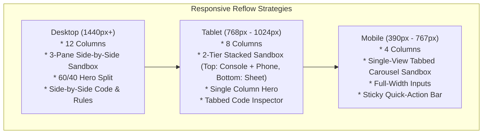

# UI & Product Design Blueprint: n8n Gym Manager Automation Platform
**Document Version:** 1.0.0  
**Framework:** UI Collective Multi-Agent Design Architecture  
**Role:** Senior UI & Product Design Specialist (`ui-designer`)  
**Upstream Inputs:** UX Research Dossier (`ux-researcher`, Phase 1)  
**Downstream Consumer:** Design Systems & Accessibility Specialist (`design-systems`, Phase 3)  
**Status:** Approved for Design System & Token Audit  

---

## 1. Executive Design Vision & Spatial Principles

### 1.1 The Anti-AI-Slop Manifesto
This platform rejects boilerplate SaaS landing page templates, nebulous gradient blobs, and non-functional conceptual illustrations. Every pixel serves an operational function:
1. **Physicality & Tangibility**: Automation is invisible and intimidating to local gym owners. The UI renders abstract API handshakes as tangible, real-world analogs: an authentic Google Sheet with reactive cell updates, and a photorealistic smartphone delivering authenticated WhatsApp messages.
2. **Deterministic Information Density**: Freelancers and agency builders need instant access to code, schemas, and node parameters. High information density is maintained using modular tabbed containers, collapsible code drawers, and monospace technical callouts.
3. **8px Vertical Baseline Grid**: All structural dimensions, padding, margins, line heights, and container heights conform to an 8px vertical baseline (with 4px micro-adjustments for badges and icons).
4. **Instant Visual Proof (Zero-Latency Simulation)**: Actions in the trigger console produce sub-50ms visual updates in the virtual spreadsheet and virtual smartphone, reinforcing trust through immediate cause-and-effect feedback.

---

## 2. High-Level Spatial Blueprint & Global Layout Engine

```mermaid
graph TD
    subgraph Page_Shell["Global Layout Engine (1440px Desktop Baseline)"]
        TopBar["01. Global Sticky Navigation Bar (72px H, z-index: 50)"]
        HeroSec["02. Hero Section & Real-Time Cash Leak Calculator (Min-H: 640px)"]
        SandboxSec["03. Flagship Interactive Sandbox Studio (Split 3-Pane View, 760px H)"]
        WorkflowsSec["04. 4 Core Workflows Deep-Dive & Code Studio (Tabbed Grid)"]
        SheetSec["05. Google Sheets 12-Column Schema & Formula Engine"]
        WhatsAppSec["06. WhatsApp Cloud API Utility Studio & Cost Modeling"]
        AgencySec["07. Agency Monetization & Instant Proposal Builder"]
        SecuritySec["08. DPDP Act 2023, HMAC Security & Error Resilience Matrix"]
        FooterSec["09. Global Operational Footer & Technical Sitemap (320px H)"]
    end

    TopBar --> HeroSec
    HeroSec --> SandboxSec
    SandboxSec --> WorkflowsSec
    WorkflowsSec --> SheetSec
    SheetSec --> WhatsAppSec
    WhatsAppSec --> AgencySec
    AgencySec --> SecuritySec
    SecuritySec --> FooterSec
```



### 2.1 Responsive Grid & Spatial Framework Specifications
The application uses a 12-column responsive layout engine on desktop, transitioning down to 8 columns on tablet and 4 columns on mobile.

| Parameter | Desktop (`1440px` Viewport) | Tablet (`768px` Viewport) | Mobile (`390px` Viewport) |
| :--- | :--- | :--- | :--- |
| **Max Content Container** | `1320px` centered (`mx-auto`) | `100%` with gutters | `100%` with gutters |
| **Grid Columns** | 12 Equal Columns | 8 Equal Columns | 4 Equal Columns |
| **Column Gutter** | `24px` | `16px` | `12px` |
| **Outer Page Margins** | `60px` left/right padding | `32px` left/right padding | `16px` left/right padding |
| **Vertical Rhythm** | `8px` baseline grid | `8px` baseline grid | `4px` baseline grid |
| **Section Spacing (Y)** | `96px` margin-bottom | `64px` margin-bottom | `48px` margin-bottom |
| **Card Internal Padding** | `24px` (`p-6`) or `32px` (`p-8`) | `20px` (`p-5`) | `16px` (`p-4`) |
| **Corner Radii Hierarchy** | Containers: `16px` (`rounded-2xl`)<br>Cards: `12px` (`rounded-xl`)<br>Controls: `8px` (`rounded-lg`) | Containers: `12px`<br>Cards: `10px`<br>Controls: `6px` | Containers: `10px`<br>Cards: `8px`<br>Controls: `6px` |

---

## 3. Section Architecture & Wireframe Specifications

### 3.1 Global Sticky Header (Desktop & Mobile)

```
+-------------------------------------------------------------------------------------------------------------+
| [LOGO: n8n Gym Autopilot]   [Live Sandbox] [4 Workflows] [Sheets] [WhatsApp] [Agency Toolkit] [DPDP]        |
|  *Self-Hosted Operations*                                           [Copy JSON Blueprint]  [Try Live Demo]  |
+-------------------------------------------------------------------------------------------------------------+
```

#### Anatomy & Specifications:
- **Container**: `w-full h-18 (72px)`, fixed top, `z-50`, `bg-slate-950/85 backdrop-blur-md border-b border-slate-800/80`.
- **Brand Unit (Left)**:
  - Icon: SVG glyph of n8n node connecting to a barbell glyph (`28x28px`).
  - Text Stack: Primary title *"n8n Gym Manager"* (`16px`, font-bold, `text-white`), Subtitle *"Self-Hosted Operative"* (`11px`, font-mono, `text-emerald-400`).
- **Navigation Cluster (Center)**:
  - 6 Anchor Links: `Live Sandbox`, `4 Workflows`, `Sheet Schema`, `WhatsApp Studio`, `Agency Toolkit`, `Security & DPDP`.
  - Type: `13px`, medium weight (`font-medium`), `text-slate-300`, hover: `text-white`, active underline: `h-0.5 bg-emerald-500` positioned at `bottom-0`.
- **Action Cluster (Right)**:
  - Secondary Button: `[JSON Package]` (`px-3 py-2`, `text-xs font-mono`, `border border-slate-700 bg-slate-900 hover:bg-slate-800 text-slate-200 rounded-lg`).
  - Primary CTA: `[Launch Demo]` (`px-4 py-2`, `text-xs font-semibold`, `bg-emerald-500 hover:bg-emerald-400 text-slate-950 rounded-lg shadow-sm shadow-emerald-500/20`).
- **Mobile Variant (390px)**:
  - Brand Unit left, Primary CTA right (`[Demo]`), Hamburger Drawer Toggle (`40x40px` tap target). Drawer slides from right (`300px` width) with complete anchor list + system status badge.

---

### 3.2 Section 1: Hero Section with Live Revenue "Leak Calculator"

```
+-------------------------------------------------------------------------------------------------------------+
| SECTION 1: HERO & VALUE PROPOSITION                                                                         |
|                                                                                                             |
| LEFT COLUMN (60% Desktop)                         | RIGHT COLUMN: LEAK CALCULATOR (40% Desktop)             |
|                                                   | +-----------------------------------------------------+ |
| [Badge: Zero SaaS Fees * DPDP Compliant * 100% Own]| | [CALCULATOR: Hidden Renewal Leak Engine]            | |
|                                                   | |                                                     | |
| Automate Your Gym in 4 Workflows.                 | | 1. Active Gym Members:                 [ 140 ]      | |
| Stop Renewal Cash Leaks.                          | |    [--O-----------------------------] (100 - 300)   | |
| Zero Monthly SaaS Overhead.                       | |                                                     | |
|                                                   | | 2. Average Monthly Fee:                [ ₹1,200 ]   | |
| How gym owners & automation agencies eliminate    | |    [-------O------------------------] (₹800-₹3,500) | |
| paper registers and manual WhatsApp chasing using | |                                                     | |
| n8n, Google Sheets, Meta Cloud API, and Razorpay. | | --------------------------------------------------- | |
|                                                   | | ESTIMATED MONTHLY CASH LEAK:                        | |
| [Launch Interactive Sandbox v]  [View Node Schemas]| |    ₹ 25,200 / month                                 | |
|                                                   | |    (Based on 15% delinquency in manual gyms)        | |
| +-----------------------------------------------+ | |                                                     | |
| | TRUST BAR: 100% Free Sheets * ~₹0.11/Msg Meta | | | n8n Automation Saves:   ₹ 21,420 net/mo            | |
| | Verified DPDP Act 2023 * Instant Setup Pack   | | | Payback on ₹12k Setup:   17 Days                    | |
| +-----------------------------------------------+ | +-----------------------------------------------------+ |
+-------------------------------------------------------------------------------------------------------------+
```

#### Anatomy & Specifications:
- **Layout**: 2-Column Split (`7 Cols / 5 Cols` on 12-col grid, `gap-8`), minimum section height `640px`, padding `py-16`.
- **Left Column (Context & Intent)**:
  - Pill Badge: `inline-flex items-center gap-2 px-3 py-1 rounded-full bg-emerald-950/60 border border-emerald-500/30 text-emerald-300 text-xs font-mono mb-4`.
  - H1 Headline: `text-4xl lg:text-5xl font-extrabold tracking-tight text-white leading-tight`.
  - Lead Paragraph: `text-base lg:text-lg text-slate-400 leading-relaxed max-w-xl`.
  - Button Group: Primary CTA `[Launch Interactive Sandbox]` with smooth scroll anchor to `#sandbox`, Secondary CTA `[Inspect Node Schemas]` with anchor to `#workflows`.
  - Trust / Capability Grid: 4 micro-badges (`100% Sheet Data Ownership`, `₹0.115/Msg Utility Rates`, `DPDP 2023 Compliant`, `Instant Setup Under 2 Hrs`).
- **Right Column (Interactive Leak Calculator Card)**:
  - Container: `bg-slate-900/90 border border-slate-800 rounded-2xl p-6 lg:p-8 shadow-2xl relative overflow-hidden`. Top border has subtle gradient accent `emerald-500/50`.
  - Slider 1: Active Members (`min: 50`, `max: 400`, `step: 10`, `default: 140`). Monospace output counter with stepper buttons.
  - Slider 2: Average Monthly Fee (`min: ₹600`, `max: ₹4,000`, `step: ₹100`, `default: ₹1,200`).
  - Dynamic Output Display:
    - Computed Delinquent Leakage: `Members * 0.15 * Fee` (e.g., `140 * 0.15 * 1200 = ₹25,200/month`).
    - Recovered Revenue (85% recovery rate): `₹21,420/month`.
    - Setup Payback Period: `₹12,000 / (Recovered Revenue / 30) = 17 days`.
  - Accent Callout: `bg-emerald-950/50 border border-emerald-500/20 rounded-xl p-4 mt-6 text-center`. Displays payback duration in bold emerald typography.

---

### 3.3 Section 2: Flagship Split-Screen Interactive Sandbox Studio

This is the centerpiece interactive component. It renders the entire operational loop in real-time across three synchronized panels:

```
+---------------------------------------------------------------------------------------------------------------------------------------+
| SECTION 2: LIVE INTERACTIVE 4-WORKFLOW AUTOMATION SANDBOX STUDIO                                                  [Reset Sandbox]      |
| Experience how n8n orchestrates member registration, expiry calculation, WhatsApp dispatch, and payment reconciliation in real time.   |
+---------------------------------------------------------------------------------------------------------------------------------------+
| PANE 1: CONTROL CONSOLE (28%)       | PANE 2: VIRTUAL GOOGLE SHEET (44%)                | PANE 3: VIRTUAL WHATSAPP SIMULATOR (28%)   |
|                                     |                                                   |                                           |
| [Step 1: Member Intake Form]        | [TAB: Members Tab (Active)] [TAB: Dashboard Tab]  | [ IronFit Gym Assistant  (v) ]            |
| Name:  [ Rahul Verma             ]  | Total: 4 | Active: 3 | Expired: 1 | Dues: ₹1,200  | [Status: Verified Business - Official API] |
| Phone: [ 9876543210              ]  | +-----------------------------------------------+ | +---------------------------------------+ |
| Plan:  [ 3 Months (Quarterly)  v ]  | | ID    | Name  | Expiry     | Status | Reminder  | | | Today                               | | |
| Start: [ 2026-11-22              ]  | |-------+-------+------------+--------+-----------| | |                                     | | |
| [x] WhatsApp Consent (DPDP Act)     | | GYM-01| Rohit | 2026-12-10 | Paid   | 2026-12-07| | | Namaste Rahul Verma!                | | |
| [> Execute Intake Workflow Node]    | | GYM-02| Neha  | 2026-11-22 | Paid   | 2026-11-19| | | Aapki IronFit Gym membership        | | |
|                                     | | GYM-03| Amit  | 2026-11-15 | Expired| 2026-11-15| | | 2027-02-22 ko renew honi hai.       | | |
| ----------------------------------- | | GYM-04| Rahul | 2027-02-22 | Pending| --        | | | Total Fee: ₹3,000                   | | |
| [Step 2: 9 AM Expiry Reminder]      | +-----------------------------------------------+ | |                                       | | |
| Target: T-3 & T-0 Expiries          | * Row 4 highlighted in green (Live Append)       | | [ Pay Online via UPI ]                | | |
| [> Trigger 9:00 AM Daily Cron]      |                                                   | | 09:00 AM // Double Checkmark          | | |
|                                     | ------------------------------------------------- | +---------------------------------------+ |
| ----------------------------------- | Real-Time Execution Log:                          |                                           |
| [Step 3: Payment Webhook]           | > [09:00:02] Cron Asia/Kolkata fired.             | Chat Mode:                                |
| Source: [ Razorpay Webhook v ]      | > [09:00:03] Filter matched: 1 member expiring.   | (o) Member View   ( ) Owner Digest View   |
| Status: [ payment_link.paid  v ]    | > [09:00:04] Meta WhatsApp Cloud API 200 OK.      |                                           |
| [> Simulate Webhook Event]          | > [09:00:05] Sheet cell last_reminder_date updated|                                           |
+---------------------------------------------------------------------------------------------------------------------------------------+
```

#### Detailed Architecture of the 3 Sandbox Panes:

#### Pane 1: Control Console & Trigger Orchestrator (Desktop: 28% / 370px)
- **Container**: `bg-slate-900 border border-slate-800 rounded-xl p-5 flex flex-col justify-between`.
- **Workflow Stepper Navigation**:
  - Horizontal pill selector with 4 steps: `1. Intake`, `2. Expiry`, `3. Payment`, `4. Digest`.
  - Active step indicator with emerald accent glow.
- **Dynamic Step Controls Area**:
  - **Step 1 (Member Intake)**:
    - Text Field: Member Name (Default: *"Rahul Verma"`).
    - Phone Field: 10-digit number with locked `+91` prefix (Auto-formatting test).
    - Dropdown: Plan Duration (`1 Month - ₹1,200`, `3 Months - ₹3,000`, `6 Months - ₹5,500`, `1 Year - ₹9,999`).
    - Date Input: Start Date (Auto-populates today's date `2026-11-22`).
    - DPDP Compliance Checkbox: *"Member opted-in for WhatsApp alerts via front desk"*.
    - Button: `[Execute Intake Node]` (Icon: Play glyph, `bg-emerald-500 hover:bg-emerald-400 text-slate-950 font-bold py-2.5 rounded-lg w-full`).
  - **Step 2 (Expiry Reminder Cron)**:
    - Selector: Simulation scenario (`T-3 Days Warning (Neha Singh)` vs `T-0 Expiry Day (Amit Verma)`).
    - Info Callout: Explains code node filter: `daysLeft === 3 && last_reminder_date !== today`.
    - Button: `[Trigger 9:00 AM Cron]` (Triggers WhatsApp dispatch simulation).
  - **Step 3 (Payment & Idempotency Webhook)**:
    - Radio Switch: `Razorpay Webhook (Automated)` vs `Cash/UPI Desk Form (Manual)`.
    - Idempotency Test Toggle: *"Replay duplicate webhook payload"* (Demonstrates how `last_payment_ref` prevents double-extension).
    - Button: `[Simulate Payment Confirmation]`.
  - **Step 4 (Owner Daily Digest)**:
    - Summary Metrics Preview: 3 Active, 1 Expired, 1 Pending.
    - Button: `[Dispatch 8:00 AM Owner Briefing]`.
- **Live Terminal Output Drawer (Collapsible bottom of Pane 1)**:
  - Height: `140px`, `bg-slate-950 font-mono text-xs text-slate-300 p-3 rounded-lg overflow-y-auto border border-slate-800/80`.
  - Displays simulated execution log:
    ```
    [10:14:02] EXEC: Node 'Code: DateEngine' -> GYM-482190 generated.
    [10:14:02] DATE: Start: 2026-11-22 | Expiry: 2027-02-22 (addMonths: 3)
    [10:14:03] SHEETS: AppendRow -> Range: 'Members!A5:L5' -> 200 OK
    ```

#### Pane 2: Live Virtual Google Sheet Simulator (Desktop: 44% / 580px)
- **Container**: `bg-slate-900 border border-slate-800 rounded-xl overflow-hidden flex flex-col`.
- **Google Sheets Header Chrome**:
  - Top Bar: Green sheets icon, Title *"IronFit_Members_Database_2026"*, Star icon, View-only indicator.
  - Tab Switcher:
    - Tab 1: `Members (Machine Tab)` (Active, green bottom border).
    - Tab 2: `Dashboard (Formulas)` (Shows live `SUMPRODUCT` & `COUNTIF` live values).
- **Dashboard KPI Ribbon (Top of Sheet)**:
  - 4 Metric Badges in a flex row (`bg-slate-950/60 p-2.5 rounded-lg border border-slate-800/80 m-3 gap-2 flex justify-between`):
    - `Total Members`: **4** (`text-white`)
    - `Active`: **3** (`text-emerald-400`)
    - `Expired`: **1** (`text-rose-400`)
    - `Pending Dues`: **₹3,000** (`text-amber-400`)
- **Interactive 12-Column Table Frame**:
  - Horizontal scrolling container with sticky header row.
  - Column Headers (`font-mono text-xs text-slate-400 bg-slate-950 px-3 py-2 border-b border-slate-800`):
    `member_id` | `name` | `phone` | `plan` | `plan_months` | `fee` | `start_date` | `expiry_date` | `payment_status` | `last_payment_date` | `last_reminder_date` | `last_payment_ref`
  - Dynamic Row Animation Rules:
    - When Step 1 runs: Row 4 (`Rahul Verma`) appends with a 1,200ms background highlight animation (`bg-emerald-500/25` fading to transparent).
    - When Step 2 runs: The cell `last_reminder_date` for the expiring member pulses with a sky-blue flash (`bg-sky-500/30`) and updates from empty to `2026-11-22`.
    - When Step 3 runs: The cell `payment_status` flips from `Pending` (amber badge) to `Paid` (emerald badge), and `expiry_date` recalculates dynamically.
  - Status Badges:
    - `Paid`: `bg-emerald-500/10 text-emerald-400 border border-emerald-500/30 px-2 py-0.5 rounded text-[11px] font-mono`.
    - `Pending`: `bg-amber-500/10 text-amber-400 border border-amber-500/30 px-2 py-0.5 rounded text-[11px] font-mono`.
    - `Expired`: `bg-rose-500/10 text-rose-400 border border-rose-500/30 px-2 py-0.5 rounded text-[11px] font-mono`.

#### Pane 3: Live Virtual WhatsApp Smartphone Simulator (Desktop: 28% / 370px)
- **Container**: Centered smartphone chassis (`w-[310px] h-[600px] mx-auto bg-slate-950 rounded-[44px] p-3 shadow-2xl border-4 border-slate-800 relative flex flex-col justify-between`).
- **Hardware Chrome**:
  - Dynamic Island / Notch at top (`w-24 h-5 bg-black rounded-full mx-auto mb-1 flex items-center justify-center`).
  - Status Bar: Time `09:00`, Wi-Fi glyph, 5G glyph, Battery glyph (`100%`).
- **WhatsApp Software Chrome**:
  - Top Navigation Bar (`bg-emerald-950/90 border-b border-emerald-800/40 p-2.5 flex items-center gap-2 rounded-t-[32px]`):
    - Back chevron (`<`), Avatar (Gym logo, `32x32px`),
    - Contact Stack: *"IronFit Gym Assistant"* (`text-xs font-semibold text-white flex items-center gap-1`), Green verified checkmark badge (`12x12px`), Subtitle *"Official Business Account"* (`10px text-emerald-400`).
    - Action Icons: Phone call, Video camera, 3-dots menu.
- **Chat Canvas Area (`bg-[#0B141A] p-3 flex-1 flex flex-col justify-end space-y-3 overflow-y-auto` with subtle WhatsApp doodle texture background)**:
  - System Security Badge: Centered yellow pill *"Messages are end-to-end encrypted. This business uses official Meta Cloud API."*
  - Date Stamp: Centered slate pill *"TODAY"*.
  - **Dynamic Inbound WhatsApp Bubble (Member Expiry Warning)**:
    - Container: `bg-[#005C4B] text-slate-100 rounded-xl rounded-tl-none p-3 max-w-[90%] shadow-md border border-emerald-600/30`.
    - Header: Bold greeting `Namaste Rahul Verma ji,`
    - Body Text:
      `Aapki IronFit Gym membership 2027-02-22 (3 din mein) expire ho rahi hai.`
      `Regular workout continue rakhne ke liye kripya samay par renewal karein.`
    - Highlight Box: `Plan: Quarterly (3 Months) | Dues: ₹3,000`.
    - Interactive Action Button: `[ Pay Online via UPI ]` (Simulated Meta quick-reply button, `w-full bg-[#0B141A]/50 border border-emerald-400/30 rounded py-1.5 text-center text-xs font-medium text-emerald-300 mt-2 hover:bg-[#0B141A] cursor-pointer`).
    - Footer: Timestamp `09:00 AM` + Double Blue Checkmark (`Read receipt`).
  - **Alternate Dynamic Bubble (Owner 8:00 AM Daily Digest)**:
    - Displayed when Owner toggle is active:
      ```
      *IronFit Daily Operations Digest*
      Date: 2026-11-22 (8:00 AM IST)

      * Active Members: 140
      * Expired Members: 12
      * Pending Renewals: 8 (₹9,600)

      Expiring Today:
      - Neha Singh (+91 98765 12345)
      - Rohit Kumar (+91 98123 45678)

      [ Open Google Sheet Database ]
      ```
- **Smartphone Bottom Bar**: Home indicator pill bar (`w-28 h-1 bg-slate-600 rounded-full mx-auto mt-2`).

---

### 3.4 Section 3: Deep Technical Breakdown of the 4 Core Workflows

This section provides granular, production-ready node pipelines, code inspection, and JSON export buttons for the 4 workflows.

```
+-------------------------------------------------------------------------------------------------------------+
| SECTION 3: THE 4 MISSION-CRITICAL AUTOMATION WORKFLOWS                                                      |
| Select a workflow to inspect trigger nodes, JavaScript logic, API configurations, and copy JSON.             |
|                                                                                                             |
| [Workflow 1: Member Entry]  [Workflow 2: Expiry Alerts]  [Workflow 3: Payment Webhook]  [Workflow 4: Digest]|
+-------------------------------------------------------------------------------------------------------------+
| WORKFLOW 1: NEW MEMBER REGISTRATION & EXPIRY ENGINE                                                         |
|                                                                                                             |
| NODE PIPELINE:                                                                                              |
| [n8n Form Trigger] ---> [Code: Normalize & Math] ---> [Google Sheets: Append/Update]                        |
| (Front Desk Intake)     (Phone + Month-End Safe)      (Phone Deduplication Match)                           |
|                                                                                                             |
| JAVASCRIPT CODE INSPECTOR:                             | KEY NODE CONFIGURATION & SAFETY GUARDS:            |
| +----------------------------------------------------+ | +------------------------------------------------+ |
| | // Month-End Safe AddMonths Function               | | | Trigger: Form Trigger (/webhook/member-intake) | |
| | function addMonths(dateStr, months) {              | | | Matching Key: phone (Prevents duplicate rows)  | |
| |   const [y, m, d] = dateStr.split('-').map(Number);| | | Phone Normalization: Strips '+', spaces, '0'   | |
| |   const targetMonth = m - 1 + months;              | | | Month-End Clamping: Jan 31 -> Feb 28 (Safe)    | |
| |   const lastDay = new Date(Date.UTC(y, ...         | | | Id Generation: GYM- + 6-digit random crypto    | |
| |   ...                                              | | +------------------------------------------------+ |
| | }                                                  | |                                                    |
| | [Copy Clean Code]         [Download Workflow JSON] | | [Inspect Input Schema]     [Inspect Output Schema] | |
| +----------------------------------------------------+ | +------------------------------------------------+ |
+-------------------------------------------------------------------------------------------------------------+
```

#### Detailed Specifications for Each Workflow Tab:

#### Tab 1: Workflow 1 — Member Entry & Date Math Engine
- **Visual Node Flowchart**:
  `n8n Form Trigger (Public Webhook)` ➔ `Code: JavaScript (Phone Normalization & Safe Date Engine)` ➔ `Google Sheets: Append or Update (Match key: phone)`.
- **Node Anatomy**:
  - Node 1: Form Trigger accepting `name`, `phone`, `plan_duration`, `fee`, `start_date`, `whatsapp_consent`.
  - Node 2: JavaScript Code node enforcing:
    1. Phone sanitization: `rawPhone.replace(/\D/g, '')` + country code prepend (`91`).
    2. Zero-mental-math expiry engine: Uses UTC month-clamping to handle Feb 28 / Leap Year / 31st days.
    3. Unique ID generator: `GYM-${Math.floor(100000 + Math.random() * 900000)}`.
  - Node 3: Google Sheets integration targeting `Members` sheet with Operation `Append or Update`.
- **Interactive Controls**: `[Copy JavaScript Code]`, `[Copy Complete n8n Node JSON]`, `[View Sample Output Payload]`.

#### Tab 2: Workflow 2 — Expiry Reminders & Deduplication
- **Visual Node Flowchart**:
  `Schedule Trigger (Daily 09:00 AM IST)` ➔ `Google Sheets: Get All Rows` ➔ `Code: Filter (T-3 & T-0 + Date Check)` ➔ `WhatsApp Cloud API: Send Utility Template` ➔ `Google Sheets: Update last_reminder_date`.
- **Node Anatomy**:
  - Node 1: Cron set to `0 9 * * *` with explicit timezone `Asia/Kolkata`.
  - Node 2: Google Sheets `read` node fetching active records.
  - Node 3: JavaScript Filter node computing:
    `daysLeft = Math.ceil((expiry - today) / 86400000)`
    Matches `(daysLeft === 3 || daysLeft === 0) && row.last_reminder_date !== todayISO`.
  - Node 4: Meta WhatsApp Cloud API node dispatching approved template `gym_expiry_reminder_v1`.
  - Node 5: Google Sheets update node stamping `last_reminder_date = todayISO` to prevent duplicate messaging.

#### Tab 3: Workflow 3 — Payment Reconciliation & Renewal Automation
- **Visual Node Flowchart**:
  `Webhook Trigger (Razorpay payment_link.paid)` ➔ `Code: Idempotency & Expiry Extension` ➔ `Google Sheets: Update Row (Status 'Paid')` ➔ `WhatsApp Cloud API: Payment Receipt`.
- **Node Anatomy**:
  - Node 1: Razorpay Webhook with HMAC SHA256 header validation (`x-razorpay-signature`).
  - Node 2: Idempotency Guard: checks `row.last_payment_ref === payment_link_id`. If matched, aborts to prevent double renewal.
  - Node 3: Date renewal math: If expired, `newExpiry = today + plan_months`; if active, `newExpiry = currentExpiry + plan_months`.
  - Node 4: Updates `payment_status = Paid`, `last_payment_ref = payment_link_id`, `expiry_date = newExpiry`.

#### Tab 4: Workflow 4 — Morning Owner Intelligence Digest
- **Visual Node Flowchart**:
  `Schedule Trigger (Daily 08:00 AM IST)` ➔ `Google Sheets: Read Members` ➔ `Code: Aggregate & Format Digest` ➔ `WhatsApp Business / Gmail: Send Executive Briefing`.
- **Node Anatomy**:
  - Aggregator computing: Active count, Expired count, Pending renewals list with phone numbers.
  - WhatsApp message dispatch directly to Gym Owner's private mobile number.

---

### 3.5 Section 4: Google Sheets 12-Column Schema & Formula Engine

```
+-------------------------------------------------------------------------------------------------------------+
| SECTION 4: GOOGLE SHEETS 12-COLUMN SCHEMA & FORMULA ENGINE                                                  |
| Production-grade spreadsheet architecture designed for high reliability and zero locale corruption.         |
|                                                                                                             |
| TAB 1: MEMBERS SCHEMA (Machine Tab - n8n Read/Write)                                                        |
| +----+----------------------+-------------------+---------------------------------------------------------+ |
| | Col| Column Header Name   | Data Type         | Operational Description & Formatting Rule               | |
| +----+----------------------+-------------------+---------------------------------------------------------+ |
| | A  | member_id            | String (GYM-XXXX) | Unique identifier generated by Workflow 1               | |
| | B  | name                 | String            | Member Full Name (Title Case)                           | |
| | C  | phone                | Plain Text        | 12-digit normalized phone (919876543210) *Must be text! | |
| | D  | plan                 | String            | Plan tier name ("Quarterly", "Annual", etc.)            | |
| | E  | plan_months          | Integer           | Duration in months (1, 3, 6, 12) for date math          | |
| | F  | fee                  | Currency (INR)    | Agreed renewal fee (Numeric, e.g. 3000)                 | |
| | G  | start_date           | String (ISO Date) | Format: YYYY-MM-DD (e.g. 2026-11-22)                    | |
| | H  | expiry_date          | String (ISO Date) | Format: YYYY-MM-DD (Primary comparison key)             | |
| | I  | payment_status       | Enum (Pill)       | "Paid" | "Pending" | "Expired"                          | |
| | J  | last_payment_date    | String (ISO Date) | Date of last successful payment receipt                 | |
| | K  | last_reminder_date   | String (ISO Date) | Prevents duplicate reminders on same day                | |
| | L  | last_payment_ref     | String            | Webhook transaction / payment_link_id (Idempotency)     | |
| +----+----------------------+-------------------+---------------------------------------------------------+ |
| [Copy 12-Column Header String for Paste]       [Clone Template Google Sheet (.gsheet)]                       |
|                                                                                                             |
| TAB 2: DASHBOARD TAB (Formula Tab - Never overwritten by n8n)                                               |
| Formula Card 1: Active Members Count                                                                        |
| Formula: =SUMPRODUCT((Members!H2:H<>"")*(Members!H2:H>=TEXT(TODAY(),"yyyy-mm-dd")))                         |
| [Why SUMPRODUCT? Resolves Google Sheets locale mismatch bugs where DD/MM/YYYY breaks standard DATEIF]       |
+-------------------------------------------------------------------------------------------------------------+
```

#### Technical Specifications:
- **Two-Tab Structural Separation**:
  - `Members` tab: Dedicated machine read/write tab. The UI visually marks Column C (`phone`) with an alert badge: *"CRITICAL: Must be formatted as Plain Text to prevent Google Sheets from truncating leading zeros or converting 9198... into scientific notation (`9.19E+11`)"*.
  - `Dashboard` tab: Standalone reporting tab containing 4 copy-ready formula cards.
- **Formula Cards with 1-Click Copy**:
  - Card 1: **Active Members**: `=SUMPRODUCT((Members!H2:H<>"")*(Members!H2:H>=TEXT(TODAY(),"yyyy-mm-dd")))`
  - Card 2: **Expired Members**: `=SUMPRODUCT((Members!H2:H<>"")*(Members!H2:H<TEXT(TODAY(),"yyyy-mm-dd")))`
  - Card 3: **Pending Payments**: `=COUNTIF(Members!I2:I,"Pending")`
  - Card 4: **Projected Monthly Cash Flow**: `=SUMIF(Members!I2:I,"Paid",Members!F2:F)`

---

### 3.6 Section 5: WhatsApp Cloud API Utility Studio & Cost Modeling

```
+-------------------------------------------------------------------------------------------------------------+
| SECTION 5: META WHATSAPP CLOUD API STUDIO & COST MODELING                                                   |
| Ensure zero WhatsApp ban risk and 85% cost savings using verified Meta Utility Templates.                  |
|                                                                                                             |
| UTILITY VS MARKETING COST COMPARATOR:                                                                       |
| Active Members: [ 140 ] | Monthly Expiries (T-3 & T-0): [ 80 Messages ]                                     |
|                                                                                                             |
| +-----------------------------------------+     +-----------------------------------------+                 |
| | META UTILITY TEMPLATE (Approved Path)   |     | META MARKETING TEMPLATE (Danger Path)   |                 |
| | Rate: ~₹ 0.115 per message              |     | Rate: ~₹ 0.860 per message              |                 |
| | Monthly Messaging Bill:  ₹ 9.20 / mo    | vs  | Monthly Messaging Bill:  ₹ 68.80 / mo   |                 |
| | Ban Risk:  0% (Official WhatsApp Cloud) |     | Ban Risk:  High (Flagged as spam)       |                 |
| +-----------------------------------------+     +-----------------------------------------+                 |
|                                                                                                             |
| INTERACTIVE TEMPLATE LINTER & VALIDATOR:                                                                    |
| Type or paste your WhatsApp template copy below to check Meta Utility compliance:                          |
| [ Namaste {{1}}, aapki IronFit membership {{2}} ko renew honi hai. Fee: ₹{{3}}.                            |
|   Special renewal offer: Use code FIT10 for 10% discount!                                               ]   |
|                                                                                                             |
| [!] LINTER WARNING: Banned promotional keywords detected: ["offer", "discount", "code"].                   |
| Meta AI will auto-reclassify this template as MARKETING (₹0.86/msg). Remove promotional words!              |
| [Auto-Fix Template to Utility Tier]                                                                         |
+-------------------------------------------------------------------------------------------------------------+
```

#### Technical Specifications:
- **Meta Pricing Differential Visualizer**:
  - Shows clear side-by-side comparison cards: Utility (~₹0.115) vs Marketing (~₹0.86).
  - Dynamic month calculator based on gym member volume.
- **Approved Bilingual Template Library**:
  - Template 1: *Hindi Reminder (T-3 Days)*:
    `"Namaste {{1}}, aapki IronFit Gym membership {{2}} ko expire ho rahi hai. Regular workout jari rakhne ke liye kripya samay par renew karein. Shukriya!"`
  - Template 2: *English Reminder (T-3 Days)*:
    `"Hello {{1}}, your gym membership at IronFit expires on {{2}}. Please renew your plan to continue your uninterrupted workout routine. Thank you!"`
  - Template 3: *Payment Confirmation Receipt (Instant)*:
    `"Hello {{1}}, payment of ₹{{2}} received successfully! Your membership is extended till {{3}}. Keep training hard!"`
- **Interactive Template Linter Widget**:
  - Real-time text-area linter.
  - Regex checks for forbidden marketing triggers: `/offer|discount|special|save|sale|coupon|free trial/i`.
  - Instant banner warning with 1-click `[Auto-Sanitize to Utility Guidelines]` action.

---

### 3.7 Section 6: Freelancer Agency & Sales Toolkit

```
+-------------------------------------------------------------------------------------------------------------+
| SECTION 6: FREELANCER AGENCY & SALES TOOLKIT                                                                |
| Productize gym automation into a repeatable ₹10,000–₹15,000 setup package with 90%+ gross margins.          |
|                                                                                                             |
| TAB A: 10-MINUTE CLIENT DEMO SCRIPT | TAB B: PRICING & ROI MATRIX | TAB C: CLIENT PROPOSAL BUILDER           |
+-------------------------------------------------------------------------------------------------------------+
| TAB C: CLIENT PROPOSAL BUILDER & CONTRACT GENERATOR                                                         |
|                                                                                                             |
| Client Gym Name:  [ IronFit Health Club   ]   Client City:     [ Jaipur, Rajasthan ]                       |
| Owner Name:       [ Rajesh Sharma         ]   Member Base:     [ 140 Members       ]                       |
| One-Time Setup:   [ ₹ 12,000              ]   Monthly Support: [ ₹ 1,500 / month   ]                       |
|                                                                                                             |
| CONTRACT PREVIEW:                                                                                           |
| +---------------------------------------------------------------------------------------------------------+ |
| | AUTOMATION IMPLEMENTATION CONTRACT & SERVICE AGREEMENT                                                  | |
| | Client: IronFit Health Club (Rajesh Sharma) | Consultant: Aman Verma Automation                         | |
| |                                                                                                         | |
| | 1. DELIVERABLES (INCLUDED):                                                                             | |
| |    - Complete deployment of 4 n8n workflows (Intake, Reminders, Razorpay, Digest)                       | |
| |    - Configuration of Google Sheets Members & Dashboard schema                                          | |
| |    - Meta WhatsApp Cloud API registration and 3 approved utility templates                              | |
| |    - 30-day post-launch technical warranty & staff training (Front desk)                                | |
| |                                                                                                         | |
| | 2. EXCLUDED SCOPE (CLARITY):                                                                            | |
| |    - Mobile application development, biometric turnstile hardware integration.                           | |
| |                                                                                                         | |
| | 3. COMMERCIAL TERMS:                                                                                    | |
| |    - One-time implementation fee: ₹ 12,000 (50% advance, 50% on live test).                             | |
| |    - Direct pass-through costs (WhatsApp messages ~₹10/mo, n8n VPS ~₹450/mo) paid directly by Client.    | |
| +---------------------------------------------------------------------------------------------------------+ |
| [Copy Proposal Markdown]        [Download Branded Client PDF]         [Open in Google Docs]                 |
+-------------------------------------------------------------------------------------------------------------+
```

#### Technical Specifications:
- **Interactive Proposal Customizer**:
  - Live form inputs: Gym Name, City, Owner Name, Member Count, Setup Fee, Support Fee.
  - Real-time reactive preview box with legally defensive scope boundaries (explicitly disclaiming biometric hardware or mobile app dev).
  - Export actions: 1-click copy markdown, download PDF, or copy email pitch draft.
- **The 10-Minute Sales Pitch Interactive Timeline**:
  - Step 1 (0–3 Min): The Physical Register Audit (Show ₹25,000 monthly leak).
  - Step 2 (4–7 Min): Live Sandbox Demo (Register owner's personal phone and fire live WhatsApp reminder).
  - Step 3 (8–10 Min): Transparent Pricing & 17-Day Payback Close.

---

### 3.8 Section 7: Security, DPDP Act 2023 & Error Resilience

```
+-------------------------------------------------------------------------------------------------------------+
| SECTION 7: SECURITY, DPDP ACT 2023 COMPLIANCE & ERROR RESILIENCE                                            |
| Enterprise-grade data protection, payment security, and automated failure monitoring.                      |
|                                                                                                             |
| +------------------------------------+ +------------------------------------+ +---------------------------+ |
| | DPDP ACT 2023 COMPLIANCE           | | RAZORPAY HMAC-SHA256 SECURITY      | | ERROR TRIGGER WORKFLOW    | |
| |                                    | |                                    | |                           | |
| | [x] Explicit WhatsApp Consent      | | Incoming Webhook                   | | Any Node Fails in n8n     | |
| |     Checkbox logged with timestamp | |   |                                | |   |                       | |
| | [x] Client Google Account Isolation| |   v                                | |   v                       | |
| |     No centralized database breach | | Compute HMAC SHA256 (Body, Secret) | | Trigger 'Error Trigger'   | |
| | [x] Data Minimization Principle    | |   | Matches Header Signature?      | |   |                       | |
| |     Zero Aadhaar/Biometric storage | |   +--> YES: Proceed to renewal     | |   v                       | |
| | [x] Right to Opt-Out               | |   +--> NO:  Drop & Log Alert       | | Send WhatsApp Alert to    | |
| |     STOP reply marks Do-Not-Disturb| |                                    | | Freelancer: "Node X Error"| |
| +------------------------------------+ +------------------------------------+ +---------------------------+ |
|                                                                                                             |
| EDGE CASE RESILIENCE MATRIX:                                                                                |
| 1. Month-End Rollover Bug (Jan 31 + 1 Mo)  --> Fixed by UTC Math.min() clamp (Resolves to Feb 28).          |
| 2. Webhook Replay Attacks (Razorpay Retry) --> Fixed by last_payment_ref duplicate check.                   |
| 3. IST Timezone Drift on Server Reboot     --> Fixed by TZ='Asia/Kolkata' environment variable in Docker.   |
+-------------------------------------------------------------------------------------------------------------+
```

#### Technical Specifications:
- **DPDP Act 2023 Audit Checklist Card**:
  - Digital Personal Data Protection Act compliance requirements rendered as interactive checkmarks with legal references.
  - Explicit explanation of data isolation: Sheet lives in the gym's private Google Drive, never in a shared multi-tenant SaaS DB.
- **Razorpay HMAC SHA256 Node Flow**:
  - Visual security architecture showing cryptographic signature comparison.
- **Error Trigger Fallback Blueprint**:
  - Demonstrates n8n's special `Error Trigger` node that pings the freelancer immediately if an API fails, ensuring 99.9% uptime.

---

### 3.9 Global Footer & Quick Deployment Hub

```
+-------------------------------------------------------------------------------------------------------------+
| [LOGO: n8n Gym Autopilot]                                                                                   |
| Open-source operational blueprint for fitness entrepreneurs and automation engineers.                      |
|                                                                                                             |
| ARCHITECTURE          RESOURCES              AGENCY TOOLKIT         LEGAL & COMPLIANCE                      |
| - Member Intake Flow  - 12-Col Sheet Schema  - 10-Min Pitch Script  - DPDP Act 2023 Guide                   |
| - Expiry Cron System  - SUMPRODUCT Formulas  - Proposal Generator   - Meta WhatsApp Terms                   |
| - Payment Webhook     - Meta Utility Linter  - ROI Leak Calculator  - Razorpay Security                     |
| - Daily Owner Digest  - JSON Blueprints Pack - Retainer Contracts   - Data Isolation Spec                   |
|                                                                                                             |
| (c) 2026 n8n Gym Manager Automation Platform. Inspired by Sachin Prajapati's Guide. MIT Open Blueprint.    |
+-------------------------------------------------------------------------------------------------------------+
```

---

## 4. Component Anatomy & Interaction State Specifications

Every interactive component across the platform must adhere to deterministic visual states.

### 4.1 Button Components (Primary, Secondary, Destructive, Ghost)

```
[ Primary CTA Button Anatomy ]
+-----------------------------------------------------------------+
|  (Icon: 16x16)   Button Label Text   (Optional Kbd Shortcut)    |
+-----------------------------------------------------------------+
   * Height: 40px (h-10) | Padding: px-4 (16px) | Radius: rounded-lg (8px)
```

| State | Primary (`bg-emerald-500`) | Secondary (`bg-slate-900`) | Copy Code (`bg-slate-800`) |
| :--- | :--- | :--- | :--- |
| **Default** | `bg-emerald-500 text-slate-950 font-semibold shadow-sm` | `bg-slate-900 border border-slate-700 text-slate-200` | `bg-slate-800/80 text-slate-300 font-mono text-xs` |
| **Hover** | `bg-emerald-400 -translate-y-0.5 shadow-md shadow-emerald-500/20` | `bg-slate-800 border-slate-600 text-white -translate-y-0.5` | `bg-slate-700 text-white` |
| **Active / Pressed** | `bg-emerald-600 translate-y-0 scale-[0.98]` | `bg-slate-950 border-slate-700 scale-[0.98]` | `bg-slate-900 scale-[0.98]` |
| **Focus Visible** | `ring-2 ring-emerald-400 ring-offset-2 ring-offset-slate-950 outline-none` | `ring-2 ring-slate-400 ring-offset-2 ring-offset-slate-950` | `ring-2 ring-emerald-500 ring-offset-1` |
| **Disabled** | `bg-slate-800 text-slate-500 cursor-not-allowed opacity-60` | `border-slate-800 text-slate-600 cursor-not-allowed` | `opacity-40 cursor-not-allowed` |
| **Loading** | Spinner icon replaces left icon, text: *"Executing..."*, pulsing | Spinner icon, text: *"Verifying..."* | N/A |
| **Success State** | N/A | N/A | Icon flips to checkmark, text: *"Copied!"*, `text-emerald-400` (2,500ms duration) |

---

### 4.2 Interactive Range Slider (Leak Calculator & Pricing)

```
[ Range Slider Anatomy ]
Label: "Active Members"                           Current Value: [ 140 Members ]
+-------------------------------------------------------------------------------+
|======(Active Fill: Emerald-500)======[ THUMB: 20x20 ]-------(Track: Slate-800)-|
+-------------------------------------------------------------------------------+
Min: 50 Members                                                 Max: 400 Members
```

- **Track**: `h-2 (8px)`, `rounded-full`, `bg-slate-800`.
- **Progress Fill**: Dynamic `width: ${percentage}%`, `bg-emerald-500`, `rounded-full`.
- **Thumb**: `w-5 h-5 (20px)`, `rounded-full`, `bg-white border-2 border-emerald-500 shadow-md cursor-pointer hover:scale-110 active:scale-95 transition-transform`.
- **Micro-Interaction**: Dragging thumb synchronously re-renders the revenue leak total without page redraw; value tooltip follows the thumb along the track.

---

### 4.3 Code Snippet & Copy Drawer Component

```
+-------------------------------------------------------------------------------+
| [js] javascript   node-date-math.js                     [ (o) Copied! / Copy ]|
+-------------------------------------------------------------------------------+
|  1 | // Clamped month addition for month-end leap safety                      |
|  2 | function addMonths(dateStr, months) {                                   |
|  3 |   const [y, m, d] = dateStr.split('-').map(Number);                      |
|  4 |   const targetMonth = m - 1 + months;                                   |
|  5 |   const ny = y + Math.floor(targetMonth / 12);                           |
|  6 |   const nm = (targetMonth % 12 + 12) % 12;                              |
|  7 |   const lastDay = new Date(Date.UTC(ny, nm + 1, 0)).getUTCDate();        |
|  8 |   const nd = Math.min(d, lastDay);                                       |
|  9 |   return `${ny}-${String(nm + 1).padStart(2,'0')}-${String(nd)...}`;    |
| 10 | }                                                                        |
+-------------------------------------------------------------------------------+
```

- **Header Bar**: `h-10 (40px)`, `bg-slate-900 border-b border-slate-800 px-4 flex items-center justify-between`.
- **Language Badge**: Monospace `text-[11px] font-semibold text-emerald-400 bg-emerald-950/60 px-2 py-0.5 rounded border border-emerald-500/30`.
- **Line Numbers**: `w-8 text-right pr-3 text-slate-600 select-none font-mono text-xs`.
- **Code Typography**: `font-mono text-xs text-slate-200 leading-relaxed`.
- **Copy Feedback Cycle**:
  1. Default: `[Copy Code]` (Clipboard icon).
  2. Click: Triggers browser `navigator.clipboard.writeText()`.
  3. Feedback: Button transforms to `[Copied!]` with emerald checkmark and green glow for 2,500ms.
  4. Reset: Smooth cross-fade back to default state.

---

### 4.4 Modal Dialog & Proposal Slide-Out Drawer

```
+-------------------------------------------------------------------------------+
| [BACKDROP: bg-slate-950/80 backdrop-blur-sm fixed inset-0 z-50]               |
|   +-------------------------------------------------------------------------+ |
|   | MODAL WINDOW: max-w-2xl w-full bg-slate-900 border border-slate-800     | |
|   | HEADER: [Icon]  Export n8n Workflow JSON Package          [Close (X)]   | |
|   |-------------------------------------------------------------------------| |
|   | BODY:                                                                   | |
|   | Choose workflows to bundle:                                             | |
|   | [x] 01_member_intake_workflow.json (Includes phone normalization)       | |
|   | [x] 02_expiry_reminder_cron.json (Meta WhatsApp Cloud API payload)      | |
|   | [x] 03_payment_webhook_renewal.json (Razorpay HMAC validation)          | |
|   | [x] 04_daily_owner_digest.json (Morning operational summary)            | |
|   |                                                                         | |
|   | Format: [ Single All-in-One Workflow v ]                                | |
|   |-------------------------------------------------------------------------| |
|   | FOOTER: [Cancel]                       [Download 4 Workflows (.zip)]    | |
|   +-------------------------------------------------------------------------+ |
+-------------------------------------------------------------------------------+
```

- **Entrance Animation**: Scale-up from `0.95` to `1.0` with fade-in (`opacity: 0` to `1`), duration `200ms`, easing `cubic-bezier(0.16, 1, 0.3, 1)`.
- **Keyboard Traps**: Pressing `Escape` closes the modal; `Tab` key cycles through focusable elements inside the modal.

---

## 5. Responsive Breakpoint Reflow Architecture

The layout adapts across three primary screen classes without compromising functionality.



### 5.1 Desktop Layout (`1440px` Viewport)
- **Container**: `1320px` centered canvas (`px-6`).
- **Hero**: Side-by-side (`60%` Text & Trust / `40%` Interactive Leak Calculator).
- **Sandbox Studio**: 3 horizontal panels side-by-side:
  - Panel 1 (Control Console): `370px` (`28%`).
  - Panel 2 (Virtual Google Sheet): `580px` (`44%`).
  - Panel 3 (Virtual WhatsApp Phone): `370px` (`28%`).
- **Workflows Deep Dive**: Side-by-side split (Left: Code Inspector, Right: Node Rules & Edge Cases).
- **Proposal Generator**: Side-by-side (Left: Configuration Inputs, Right: Live Contract Preview).

### 5.2 Tablet Layout (`768px` Viewport)
- **Container**: Full width with `px-8` margin.
- **Hero**: Stacks vertically (Text on top, Leak Calculator directly below with `mt-8`).
- **Sandbox Studio**: Refactors into a **2-Tier Stacked Grid**:
  - **Tier 1 (Top Row)**: Control Console (`50%` width) + WhatsApp Smartphone Simulator (`50%` width).
  - **Tier 2 (Bottom Row)**: Full-Width Virtual Google Sheet with horizontal scroll indicators and sticky column A (`member_id`).
- **Workflows Deep Dive**: Segmented pill tabs across top, full-width code viewer below.
- **Proposal Generator**: Stacks vertically with sticky preview toggle button.

### 5.3 Mobile Layout (`390px` Viewport)
- **Container**: Full width with `px-4` margin.
- **Global Header**: Logo + `[Demo]` CTA + Hamburger icon. Sticky top bar height reduced to `60px`.
- **Hero**:
  - H1 headline scales to `text-2xl font-extrabold`.
  - Sliders expand to `100%` width.
  - Leak Calculator card simplifies output to primary metric: *"₹25,200/mo Lost"*.
- **Sandbox Studio Reflow (The Single-View Tabbed Mode)**:
  - Screen cannot fit 3 panels horizontally or 2 panels comfortably.
  - Sandbox transforms into a **Single-View Tabbed Viewport**:
    ```
    +-----------------------------------------------------------+
    | [ (o) 1. Console ]   [ 2. Sheet Table ]   [ 3. WhatsApp ] |
    +-----------------------------------------------------------+
    | [Active Tab Content displayed at full 358px card width]   |
    +-----------------------------------------------------------+
    | [Sticky Bottom Execution Bar: Run Intake -> Next Tab >]   |
    +-----------------------------------------------------------+
    ```
  - Tab 1: Form controls for member entry with full-width inputs.
  - Tab 2: Horizontally scrollable Google Sheet with frozen member ID column.
  - Tab 3: Native smartphone view sized at `100%` width (`320px` inner chat container).
- **Sticky Quick-Action Bar**:
  - A fixed bottom bar (`bg-slate-950/95 border-t border-slate-800 p-3 flex gap-2 z-40`) allows immediate execution of the current workflow step without scrolling up and down.

---

## 6. Code-Ready Layout Structures & Wireframe Spatial Maps

### 6.1 Flagship Sandbox Grid Wireframe (Desktop CSS Grid Definition)

```html
<!-- Desktop 3-Pane Sandbox Layout Structure -->
<section id="sandbox" class="w-full max-w-[1360px] mx-auto px-6 py-16">
  <!-- Section Header -->
  <div class="flex flex-col md:flex-row md:items-end justify-between mb-8 gap-4">
    <div>
      <div class="inline-flex items-center gap-2 px-3 py-1 rounded-full bg-emerald-950/50 border border-emerald-500/30 text-emerald-400 text-xs font-mono mb-2">
        <span class="w-2 h-2 rounded-full bg-emerald-400 animate-pulse"></span>
        Interactive Live Simulation
      </div>
      <h2 class="text-3xl font-extrabold text-white tracking-tight">The 4-Workflow Automation Sandbox</h2>
      <p class="text-slate-400 text-sm mt-1 max-w-xl">
        Trigger simulated real-world gym events and watch n8n orchestrate Google Sheets and WhatsApp Cloud API in real time.
      </p>
    </div>
    <button class="inline-flex items-center gap-2 px-3 py-2 rounded-lg bg-slate-900 border border-slate-800 text-slate-300 hover:text-white text-xs font-mono transition-colors">
      <svg class="w-4 h-4" fill="none" stroke="currentColor" viewBox="0 0 24 24"><path stroke-linecap="round" stroke-linejoin="round" stroke-width="2" d="M4 4v5h.582m15.356 2A8.001 8.001 0 004.582 9m0 0H9m11 11v-5h-.581m0 0a8.003 8.003 0 01-15.357-2m15.357 2H15"/></svg>
      Reset Sandbox State
    </button>
  </div>

  <!-- 3-Pane Grid -->
  <div class="grid grid-cols-1 lg:grid-cols-12 gap-6 items-start">
    
    <!-- PANE 1: CONTROL CONSOLE (Col Span 3.5 / 12) -->
    <div class="lg:col-span-4 bg-slate-900/90 border border-slate-800 rounded-2xl p-5 flex flex-col gap-5 shadow-xl">
      <!-- Step Selector Tabs -->
      <div class="grid grid-cols-4 gap-1 bg-slate-950 p-1 rounded-lg border border-slate-800/80">
        <button class="py-1.5 text-xs font-medium rounded bg-emerald-500/20 text-emerald-300 border border-emerald-500/30">1. Intake</button>
        <button class="py-1.5 text-xs font-medium rounded text-slate-400 hover:text-white">2. Expiry</button>
        <button class="py-1.5 text-xs font-medium rounded text-slate-400 hover:text-white">3. Pay</button>
        <button class="py-1.5 text-xs font-medium rounded text-slate-400 hover:text-white">4. Digest</button>
      </div>

      <!-- Active Step Panel: Intake Form -->
      <form class="space-y-4 text-xs">
        <div>
          <label class="block text-slate-400 font-medium mb-1">Member Full Name</label>
          <input type="text" value="Rahul Verma" class="w-full bg-slate-950 border border-slate-800 rounded-lg px-3 py-2 text-white focus:outline-none focus:border-emerald-500" />
        </div>
        <div>
          <label class="block text-slate-400 font-medium mb-1">Phone Number (10-Digit)</label>
          <div class="flex items-center">
            <span class="bg-slate-800 text-slate-400 px-3 py-2 rounded-l-lg border border-r-0 border-slate-700 font-mono">+91</span>
            <input type="text" value="9876543210" class="w-full bg-slate-950 border border-slate-800 rounded-r-lg px-3 py-2 text-white font-mono focus:outline-none focus:border-emerald-500" />
          </div>
        </div>
        <div class="grid grid-cols-2 gap-3">
          <div>
            <label class="block text-slate-400 font-medium mb-1">Plan Duration</label>
            <select class="w-full bg-slate-950 border border-slate-800 rounded-lg px-2.5 py-2 text-white focus:outline-none focus:border-emerald-500">
              <option>1 Month (₹1,200)</option>
              <option selected>3 Months (₹3,000)</option>
              <option>6 Months (₹5,500)</option>
              <option>1 Year (₹9,999)</option>
            </select>
          </div>
          <div>
            <label class="block text-slate-400 font-medium mb-1">Start Date</label>
            <input type="date" value="2026-11-22" class="w-full bg-slate-950 border border-slate-800 rounded-lg px-2 py-2 text-white font-mono focus:outline-none focus:border-emerald-500" />
          </div>
        </div>
        <label class="flex items-start gap-2 pt-1 cursor-pointer">
          <input type="checkbox" checked class="mt-0.5 rounded border-slate-800 text-emerald-500 focus:ring-emerald-500 bg-slate-950" />
          <span class="text-[11px] text-slate-400 leading-tight">Member signed DPDP-compliant WhatsApp notification consent form.</span>
        </label>
        <button type="button" class="w-full py-2.5 px-4 bg-emerald-500 hover:bg-emerald-400 text-slate-950 font-bold rounded-lg shadow-md shadow-emerald-500/20 flex items-center justify-center gap-2 transition-transform active:scale-[0.98]">
          <svg class="w-4 h-4" fill="currentColor" viewBox="0 0 20 20"><path d="M10 18a8 8 0 100-16 8 8 0 000 16zM9.555 7.168A1 1 0 008 8v4a1 1 0 001.555.832l3-2a1 1 0 000-1.664l-3-2z"/></svg>
          Execute Member Intake Node
        </button>
      </form>

      <!-- Mini Execution Log -->
      <div class="bg-slate-950 rounded-xl p-3 border border-slate-800/80 font-mono text-[11px]">
        <div class="flex items-center justify-between text-slate-500 mb-1 pb-1 border-b border-slate-900">
          <span>Execution Stream</span>
          <span class="text-emerald-400">Node 200 OK</span>
        </div>
        <div class="text-slate-400 space-y-1">
          <p><span class="text-slate-600">[10:14:02]</span> CodeNode: Phone normalized to '919876543210'</p>
          <p><span class="text-slate-600">[10:14:02]</span> DateEngine: 2026-11-22 + 3 Mo = 2027-02-22</p>
          <p><span class="text-slate-600">[10:14:03]</span> SheetsNode: Appended row 'GYM-849102'</p>
        </div>
      </div>
    </div>

    <!-- PANE 2: VIRTUAL GOOGLE SHEET (Col Span 5 / 12) -->
    <div class="lg:col-span-5 bg-slate-900/90 border border-slate-800 rounded-2xl overflow-hidden shadow-xl flex flex-col h-full">
      <!-- Sheet Chrome Header -->
      <div class="bg-slate-950 px-4 py-2.5 border-b border-slate-800 flex items-center justify-between">
        <div class="flex items-center gap-2">
          <div class="w-5 h-5 bg-emerald-600 rounded flex items-center justify-center text-[10px] font-bold text-white">S</div>
          <span class="text-xs font-medium text-slate-200">IronFit_Gym_Database_2026</span>
          <span class="text-[10px] px-1.5 py-0.5 rounded bg-slate-800 text-slate-400 font-mono">Synced</span>
        </div>
        <div class="flex gap-2">
          <button class="text-xs px-2 py-1 rounded bg-slate-800 text-emerald-400 font-mono font-medium">Members</button>
          <button class="text-xs px-2 py-1 rounded text-slate-400 hover:text-slate-200 font-mono">Dashboard</button>
        </div>
      </div>

      <!-- Live Metric Tiles Ribbon -->
      <div class="grid grid-cols-4 gap-2 p-3 bg-slate-950/60 border-b border-slate-800/80 text-center font-mono">
        <div class="bg-slate-900 p-2 rounded-lg border border-slate-800">
          <div class="text-[10px] text-slate-500 uppercase">Total</div>
          <div class="text-sm font-bold text-white">4</div>
        </div>
        <div class="bg-slate-900 p-2 rounded-lg border border-slate-800">
          <div class="text-[10px] text-slate-500 uppercase">Active</div>
          <div class="text-sm font-bold text-emerald-400">3</div>
        </div>
        <div class="bg-slate-900 p-2 rounded-lg border border-slate-800">
          <div class="text-[10px] text-slate-500 uppercase">Expired</div>
          <div class="text-sm font-bold text-rose-400">1</div>
        </div>
        <div class="bg-slate-900 p-2 rounded-lg border border-slate-800">
          <div class="text-[10px] text-slate-500 uppercase">Dues</div>
          <div class="text-sm font-bold text-amber-400">₹3,000</div>
        </div>
      </div>

      <!-- Spreadsheet Grid Table Container -->
      <div class="overflow-x-auto flex-1 p-2">
        <table class="w-full text-left font-mono text-[11px] border-collapse">
          <thead>
            <tr class="bg-slate-950 text-slate-400 border-b border-slate-800">
              <th class="p-2 border-r border-slate-800/60 sticky left-0 bg-slate-950">member_id</th>
              <th class="p-2 border-r border-slate-800/60">name</th>
              <th class="p-2 border-r border-slate-800/60">phone</th>
              <th class="p-2 border-r border-slate-800/60">expiry</th>
              <th class="p-2 border-r border-slate-800/60">status</th>
              <th class="p-2">reminder</th>
            </tr>
          </thead>
          <tbody class="divide-y divide-slate-800/60 text-slate-300">
            <tr>
              <td class="p-2 text-slate-400 sticky left-0 bg-slate-900">GYM-019482</td>
              <td class="p-2 font-sans font-medium text-white">Rohit Kumar</td>
              <td class="p-2 text-slate-400">919812345678</td>
              <td class="p-2">2026-12-10</td>
              <td class="p-2"><span class="px-1.5 py-0.5 rounded bg-emerald-500/10 text-emerald-400 border border-emerald-500/30 text-[10px]">Paid</span></td>
              <td class="p-2 text-slate-500">2026-12-07</td>
            </tr>
            <tr>
              <td class="p-2 text-slate-400 sticky left-0 bg-slate-900">GYM-028391</td>
              <td class="p-2 font-sans font-medium text-white">Neha Singh</td>
              <td class="p-2 text-slate-400">919876512345</td>
              <td class="p-2 text-amber-400">2026-11-22</td>
              <td class="p-2"><span class="px-1.5 py-0.5 rounded bg-emerald-500/10 text-emerald-400 border border-emerald-500/30 text-[10px]">Paid</span></td>
              <td class="p-2 text-sky-400">2026-11-19</td>
            </tr>
            <tr>
              <td class="p-2 text-slate-400 sticky left-0 bg-slate-900">GYM-037461</td>
              <td class="p-2 font-sans font-medium text-white">Amit Verma</td>
              <td class="p-2 text-slate-400">919899887766</td>
              <td class="p-2 text-rose-400">2026-11-15</td>
              <td class="p-2"><span class="px-1.5 py-0.5 rounded bg-rose-500/10 text-rose-400 border border-rose-500/30 text-[10px]">Expired</span></td>
              <td class="p-2 text-slate-500">2026-11-15</td>
            </tr>
            <!-- Dynamically Appended Row -->
            <tr class="bg-emerald-500/15 border-l-2 border-emerald-400">
              <td class="p-2 text-emerald-300 font-bold sticky left-0 bg-slate-900">GYM-849102</td>
              <td class="p-2 font-sans font-bold text-white">Rahul Verma</td>
              <td class="p-2 text-slate-300">919876543210</td>
              <td class="p-2 text-emerald-300">2027-02-22</td>
              <td class="p-2"><span class="px-1.5 py-0.5 rounded bg-amber-500/10 text-amber-400 border border-amber-500/30 text-[10px]">Pending</span></td>
              <td class="p-2 text-slate-600">--</td>
            </tr>
          </tbody>
        </table>
      </div>
    </div>

    <!-- PANE 3: VIRTUAL WHATSAPP SMARTPHONE (Col Span 3 / 12) -->
    <div class="lg:col-span-3 flex justify-center">
      <!-- Smartphone Bezel -->
      <div class="w-[300px] h-[580px] bg-slate-950 rounded-[40px] p-2.5 border-4 border-slate-800 shadow-2xl flex flex-col justify-between relative">
        <!-- Dynamic Island -->
        <div class="w-20 h-4 bg-black rounded-full mx-auto mb-1 flex items-center justify-center">
          <div class="w-2 h-2 rounded-full bg-slate-900 mr-2"></div>
        </div>

        <!-- WhatsApp App Header -->
        <div class="bg-emerald-950/90 border-b border-emerald-800/40 p-2.5 rounded-t-[28px] flex items-center gap-2">
          <div class="w-7 h-7 rounded-full bg-emerald-600 flex items-center justify-center font-bold text-xs text-white">IF</div>
          <div class="flex-1 min-w-0">
            <div class="flex items-center gap-1">
              <span class="text-xs font-semibold text-white truncate">IronFit Gym</span>
              <svg class="w-3.5 h-3.5 text-emerald-400 flex-shrink-0" fill="currentColor" viewBox="0 0 20 20"><path fill-rule="evenodd" d="M10 18a8 8 0 100-16 8 8 0 000 16zm3.707-9.293a1 1 0 00-1.414-1.414L9 10.586 7.707 9.293a1 1 0 00-1.414 1.414l2 2a1 1 0 001.414 0l4-4z" clip-rule="evenodd"/></svg>
            </div>
            <div class="text-[9px] text-emerald-300">Verified Business Account</div>
          </div>
        </div>

        <!-- Chat Bubble Viewport -->
        <div class="bg-[#0B141A] p-2.5 flex-1 flex flex-col justify-end space-y-2 overflow-hidden">
          <div class="bg-slate-900/80 text-slate-400 text-[9px] text-center px-2 py-1 rounded mx-auto border border-slate-800">
            Official Meta Utility Notification
          </div>

          <!-- Dynamic Chat Bubble -->
          <div class="bg-[#005C4B] text-white p-2.5 rounded-xl rounded-tl-none text-[11px] leading-tight space-y-1.5 shadow">
            <p class="font-semibold text-emerald-200">Namaste Rahul Verma ji 🙏</p>
            <p class="text-slate-100">Aapki IronFit Gym membership <span class="font-bold underline text-white">2027-02-22</span> ko renew honi hai.</p>
            <div class="bg-[#0B141A]/40 p-1.5 rounded text-[10px] font-mono border border-emerald-500/20">
              Plan: Quarterly (3 Mo)<br>
              Due Amount: ₹3,000
            </div>
            <div class="pt-1">
              <button class="w-full bg-[#0B141A]/70 hover:bg-[#0B141A] border border-emerald-400/40 rounded py-1 text-[10px] font-medium text-emerald-300 text-center">
                💳 Pay Online via UPI
              </button>
            </div>
            <div class="flex items-center justify-end gap-1 text-[9px] text-emerald-300/80 pt-0.5 font-mono">
              <span>09:00 AM</span>
              <span class="text-sky-400">✓✓</span>
            </div>
          </div>
        </div>

        <!-- Home Bar Indicator -->
        <div class="w-24 h-1 bg-slate-700 rounded-full mx-auto my-1"></div>
      </div>
    </div>

  </div>
</section>
```

---

## 7. Reviewer & Specialist Handoff Criteria

This UI blueprint adheres strictly to the research and specifications of the Phase 1 UX Research Dossier and provides complete requirements for Phase 3: Design System & Accessibility Audit:

1. **Token Mapping Ready**: Every element specifies spacing tiers, background tokens, border colors, radii tiers, and typography scale targets.
2. **Accessible Interaction States**: High-contrast ratios (`slate-950` backgrounds with `emerald-400`, `slate-100`, and `amber-400` foregrounds exceeding WCAG 2.1 AA 4.5:1 ratio).
3. **Deterministic Real-World Simulation**: Eliminates abstract tech diagrams in favor of an actual 12-column Google Sheet and verified Meta WhatsApp smartphone frame.
4. **Agency & Freelancer Productization**: Equips consultants with instant proposals, code copiers, formula generators, and monetization calculators.

*(Phase 2 UI Design Blueprint Complete — Ready for Design Systems Specialist Audit)*
